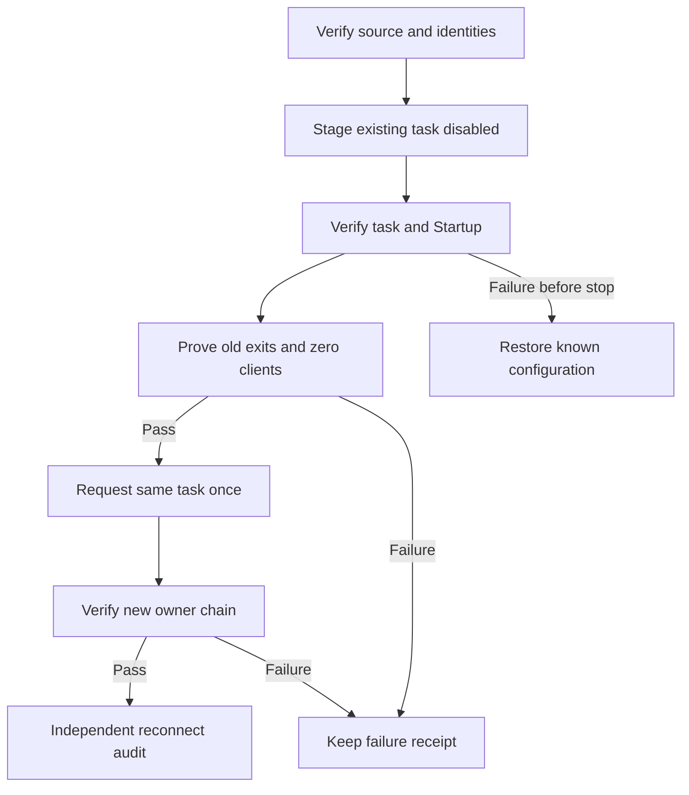

# Laptop1 existing-task adoption controller

Startup currently launches CJS directly after 20 seconds, while the existing recovery task invokes a guarded legacy watchdog after 60 seconds. This controller prepares convergence on that same recovery task: its current-CJS action becomes the owner, and the existing Startup VBS requests only that task.

Default invocation is read-only. It verifies host, owner/session and absence of a job, exact source/native dependency hashes, persisted session presence (values never exported), unchanged public install/task/Startup/legacy files, exact old process creation/argv fingerprints, complete readable Node census and absence of parallel SDK launchers. It reads the task security descriptor and validates the prepared task definition with TASK_VALIDATE_ONLY; it does not register it.

Explicit apply mode creates one detached source-bound worker. Atomic source/owner/session handshake requires parent acknowledgement before the worker can proceed. A named mutex and exclusive run directory prevent repeat execution. It backs up original task/Startup, disables the existing idle task, updates only its action and Startup, verifies settings/security/trigger preservation and rechecks old identities. Only held exact 2032/4000/12764/5520 identities may be terminated. All four exits and a zero-client/supervisor/launcher census must pass before the same task is enabled and requested once. The new CJS/client/task chain must agree on owner/session, parent identities, lock PID and one running task instance.

Before old stop intent, partial staging failures restore only known configuration. After stop intent, terminal failure is retained and no blind second launch or task recreation occurs. RPC waits and new-client waits are bounded. Console 9040, Explorer 11520, Adobe and runners are outside the stop set. Current CJS, legacy guard, trading install/research/journal/checkpoint and credentials are not changed. No WMI or persistent execution policy change is used.

Local standard-library unittest: 15 passed, 3 native Windows fixtures skipped on this Linux host. Windows CI must exercise real harmless Python-child handle termination/positive exit, PowerShell5.1 parsing without task calls, and VBScript parsing without running the task. Hosted exact-head checks, a separate native read-only check and an independent post-handoff RDC/task/process audit are required before adoption is declared. No real controller apply or task adoption occurred in this source-preparation stage.

Original preflight source: 661c36d6a704215afc59980654d6a86497bf5e91; completed native proof is in invocation-correction/. Current baseline: 249fc0edc3a51a8c26f83cf4c79a58bf9f2cb6bf after PR2649. Controller SHA256: 12459e912ec643a91afd05dc7b1f929d991c94ecb097fee635aa8e27ce37d539. Runtime receipts must retain the prospectively frozen controller commit, not a later evidence head.

Bybit Demo/Paper reference 500 USDT, Live=false; Laptop1 sole Paper owner, Laptop2 Research primary and dormant failover unchanged. Existing PID-only CJS lock, hang detection and reboot/24-hour reliability remain separate limitations.

API references:
https://learn.microsoft.com/en-us/windows/win32/taskschd/taskfolder-registertaskdefinition
https://learn.microsoft.com/en-us/windows/win32/taskschd/registeredtask-run
