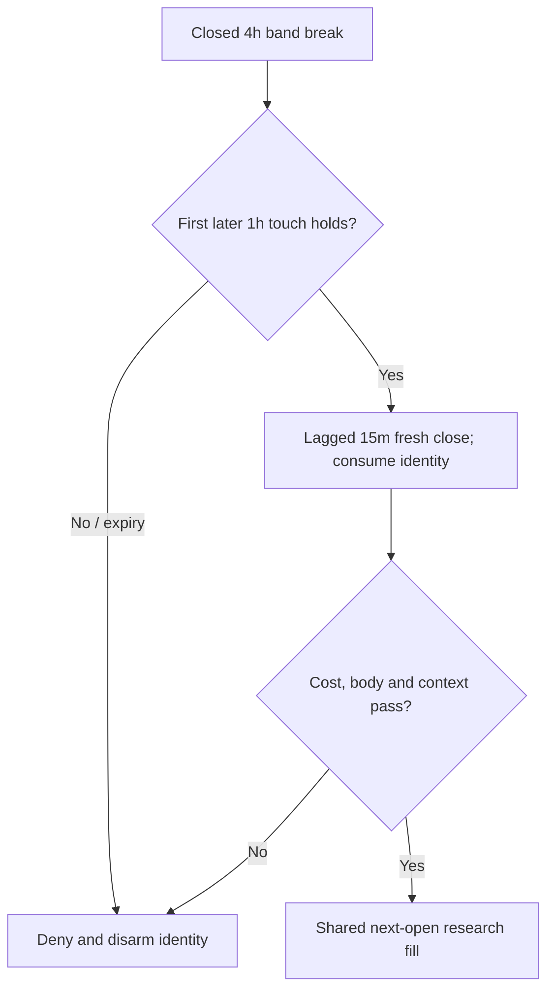

# Macro break / first retest v10 — prospective precheck

One new hypothesis is frozen before implementation or market outcomes: a closed 4h breakout of a frozen preceding 24h band, the first fully subsequent completed 1h touch-and-hold, and a separate lagged 15m fresh cross of that retest high. A fixed decision-time stress-cost feasibility screen applies to this same candidate under both cost profiles. Positive expectancy is unproved.

The parent diagnosis found near-zero conservative fixed-path price contribution against about 2.88 USDT per trip in costs. That supports studying a larger structural lifecycle and explicit cost feasibility, not changing the old Elliott economic parameters. This proposal does not claim a full Elliott count, harmonic pattern, order flow or global scientific novelty.

## Frozen lifecycle

At 4h close tau, define H/L from the SIX preceding closed 4h bars, excluding the new displacement candle. Accept only R=H-L>0 and a bullish close above H. Use that 4h candle identity and frozen band, not a later rolling rewrite. A newly accepted macro replaces old pending future state only after the current 15m decision.

Require the first subsequent completed 1h candle touching H to hold: low<=H, close>H, close>open and low>L. Its OPEN must be at/after tau and its CLOSE must be >tau and <=tau+6h. An hour overlapping the displacement is ineligible. The first touch is decisive: failure disarms the macro; a better later touch cannot revive it.

All fully subsequent completed 15m bars must keep low>L and close>H. Equality or breach invalidates before same-bar entry/retest processing. An armed retest freezes K=that 1h high. Evaluate only the READY state stored after the preceding decision. On bars 1..8 after retest confirmation, the first fresh closed cross above K emits a price event and consumes the macro, including when independent body, existing completed context, ATR or cost gates deny trading. Intrabar high alone does not trigger. Expiry, failed touch, invalidation or replacement cannot revive a consumed identity.

Processing at coincident closes: evaluate lagged state/current 15m price first; process newly completed eligible 1h bars second; process the new 4h breakout last. Retest/new macro changes affect future state. Existing h4_up and h1_vol_ok remain completed/asof and one-decision lagged.

Macro close 04:00 permits earliest full retest 04:00..05:00, known after the 05:00 decision. Earliest price decision is the next 05:00..05:15 candle close; its next bar OPEN is also timestamped 05:15 on a complete grid. Bar index/order advances even at that same UTC boundary. No earlier-bar fill or live zero-latency execution is asserted.

## Decision-time cost feasibility

Use C=current CLOSED decision close and the unchanged engine a=mean of the preceding 14 closed 15m high-low ranges after shift(1). This engine field is called atr but is not Wilder true-range ATR. Use stress f=25/10000 and s=15/10000 for both cost-profile signal arrays. Never use the unknown next open in the decision gate.

Flat round-trip quote cost per unit is Kflat=C(1+s)(1+f)-C(1-s)(1-f)=2C(f+s). Project E=C(1+s), STOP=E-1.5a, T=E+3a, X=T(1-s), Ntarget=X-E-f(E+X). Require all finite, C>0,a>0,R>0,STOP>0,R>Kflat,Ntarget>0. There is no fitted multiplier or relaxed transaction-cost schedule. Horizons 6x4h, 6h and 8x15m are fixed engineering choices, not universal laws.

The gate only checks hypothetical feasibility at decision-time C. Actual next-open gaps, fills and 1.5a/2R stop-target remain the existing shared simulator; the cost screen neither predicts a target hit nor guarantees a positive actual fill/trade. Body requirements close>open and >previous_close remain fixed. The price event is consumed even if cost admission rejects it.

## Duplicate and compatibility evidence

The source-bound inventory contains 121 registered mechanisms/94 factory contracts, plus exact old configurations/order. The prospective ID, normalized topology digest and config fingerprint are absent; all three proposed feature fields are absent. Static comparison covers the complete registered inventory and the nearest legacy/factory clauses. This is a scoped duplicate check, not proof of global uniqueness.

| Nearby existing mechanism | Shared idea | Required lifecycle difference |
|---|---|---|
| structural_pullback | Pullback continuation | Existing same-15m prior_hi reclaim has no frozen 4h identity or later 1h first-touch stage. |
| trend_vwap_pullback_reclaim | Pullback then close | Existing bar-proxy VWAP reclaim has no macro band/retest chronology or cost-budget stage. |
| prior_day_breakout_continuation | Larger range break | Existing 15m crossing a completed UTC-day high has no actual 4h breakout followed by a fully subsequent 1h touch. |
| factory_serial_prior_day_continuation | Closed calendar breakout | Flat serial/day clauses have no macro identity, first-touch consumption or retest-high fresh cross. |
| factory_causal_elliott_wave12_breakout | Lagged setup and fresh cross | Existing 3+3 15m O/A/B proxy is distinct from this actual 4h/1h staged lifecycle; no pivot/retracement count is reused. |

Current helpers/registered fields do not implement the three new fields. The candidate JSON is a proposal only; it is intentionally not loaded as a runtime contract and not added to the live factory allowlist here. Future integration should append only this candidate (prospective inventory 122/95), preserve every old normalized contract/config/order/frontier tier and retain the shared backtest AST-source hash.

## Source, trace and market gates

Next implement the one additive helper and minimal approved-field/contract integration. Synthetic source gates must cover hand temporal geometry, every-prefix/future-tail invariance across three grids, no partial/overlapping HTF visibility, first-touch denial, invalidation/expiry/equality, coincident close ordering, consumed events under body/context/ATR/cost denial, scale/UTC/cost/gap handling, all old contracts/order and shared next-open/stop-first/risk behavior. Exact-source full hosted and native source gates with actual owned exits precede a market producer.

The next fresh run needs source-bound prospective decision/fill/exit diagnostics: setup identities and confirmation, UTC/bar indices, reference/slipped prices, quantity, both fees, stop/target/atr, exit reason and cost-screen values. A separately reviewed observational hook may capture unchanged simulator execution in the isolated research child. It must not mutate local values or ordering; prove identical hand-fixture metrics and unchanged backtest AST-source hash. No hook capability or trace completeness is claimed yet. Block producer admission if that gate is unmet, rather than claiming independent numeric/Decimal/leakage QA. Do not replay v9 to obtain its missing fill trace.

Then freeze one new exact-source/data/predecessor-bound producer with exclusive output/lease and actual owned child exit. Four Training-screen cells and twelve locked exploratory rows; no observed Validation/final-fold retuning. Independent numeric/Decimal/market leakage QA and unseen prospective evidence remain separate qualification gates. No minimum-trade or maximum-trades filter, and no profitable strategy is claimed by this preregistration.

## Preserved data, economics and authority

BTC/ETH Bybit Spot long-only, closed 15m with 1h/4h, same inspected six-file archive and 60/20/20 folds. Conservative fees/slippage 10/5 bps per leg; stress 25/15. Same next-open/stop-first/1.5a/2R/64 bars, 10% cash cap, 0.1% stop risk, 5% daily loss and 10% drawdown guard. Isolated 10000 USDT per cell; owner reference 500 USDT. No fiat conversion. The same inspected historical folds are not pristine or a monthly-return study.

The completed v9 terminal ledger, not its preregistration predecessor, is required: semantic b784b409c16b77fa5d6dd5d65b7f8ed67e13e65aa6d230a74e843f9e63720e8f, exact file 14cc329d8acd02fbc3a13268826446f44d05dcf9eb299a6c13738558342f401c. Never reset old evidence or replay v8/v9. Parent computational source remains 8c06ca692a06611431730e4aeb822b1d9f47f30d; diagnosis/evidence head 214ca1864acef609a6061bd0134e881f266c809f. The proposal has no computational v10 source, tests or market results yet.

System Map: DATA-21 / RES-30 / RES-31 / RES-32 / VAL-40 / QA-41. Reuse the existing factory/pipeline/simulator/ledger and isolated Laptop2 research. Laptop1 remains sole Paper writer; failover disabled. Live, automatic Demo promotion, owner admission and official Coordinator advancement remain false. Owner install/profile/journal/authentication, Windows recovery and VPS are outside this step. Laptop1 ping timed out in this check; power/Paper/health is not inferred or changed.
