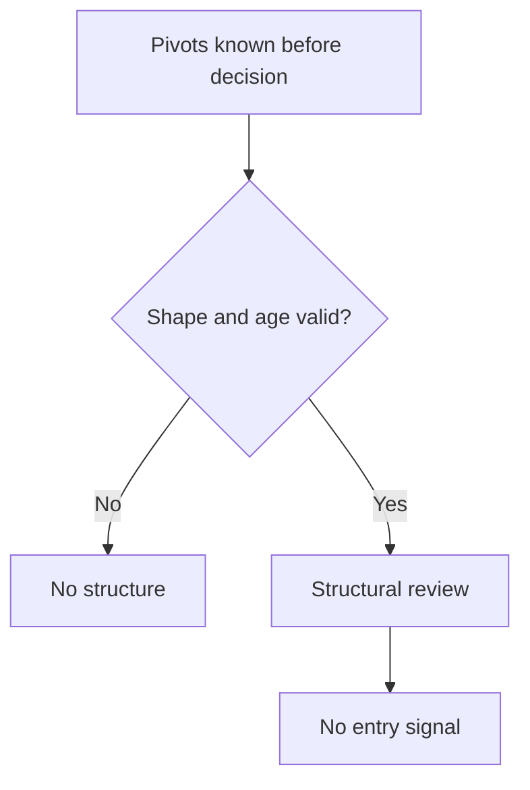

# Elliott structural review — 2026-10-15

The previously completed Elliott v9 run evaluated a three-pivot wave 1–2
breakout proxy. Its source explicitly did not claim a complete Elliott count.
The conservative Training simulations lost 7.90% for BTC and 6.74% for ETH
after costs. This review adds a small, unintegrated structural prototype which
requires five observed swings before the proposed parent correction. It does
not emit an entry signal or establish profitability.

VPS work is paused at the owner's request. Both new Windows sshd services failed
their first start and were stopped/disabled by their installers. No rescue task
or independent VPS repair acceptance is completed. Preserve that separate
partial installation and its existing identities; this review performs no
VPS, recovery, service, authentication, or Paper-runtime work.

## Verified prior evidence

The v9 native market producer ran once; it is not replayed by this review.
The exact report SHA256 is
`26bd16779f583d43c8407c65f0830fcccd4700c8b09a0f1cd1e00c5fd087f53d`.
Both the report bytes and shared backtest AST-source digest were checked again.
Only the four existing Training rows informed this review. Later folds did not
choose parameters or structure. Training covers 2022-12-01 through 2025-02-11;
these are historical-fold results, not two monthly returns or an unseen holdout.

| Asset | Costs | Closed round trips | Net return |
| --- | --- | ---: | ---: |
| ETHUSDT | stress | 129 | -9.9629% |
| ETHUSDT | conservative | 236 | -6.7411% |
| BTCUSDT | stress | 143 | -10.1125% |
| BTCUSDT | conservative | 257 | -7.9007% |

Cost profiles are independent paths; stress halts can change trade counts.
The prior aggregate diagnosis found very weak fixed-path price contribution
relative to fees/slippage. It did not establish entry-delay, exit-reason,
wave-scale, or adverse-excursion causes because the old fill trace was absent.
No old simulator economics, signed results, predecessor ledger, or cost rates
are changed here.

## What the prototype checks

`nexus_elliott_five_swing_review.py` accepts supplied confirmed pivots and uses
only those confirmed strictly before the decision index. The latest seven
must alternate low/high/low/high/low/high/low. The first six describe five
completed swings; the seventh is a proposed correction at the next degree.

The inner second low must stay above the origin, the inner third high must
exceed the first, and the inner fourth low must exceed the first high. The fifth
must exceed the third: truncated fifths and diagonals are outside this narrow
review. The inner third swing must exceed at least one of swings one/five in
both arithmetic and percentage price movement; tied-shortest cases are rejected.
This dual strict screen is an explicitly conservative engineering choice.

The proposed parent correction must stay between origin and fifth high and
retrace 0.382–0.786 of that complete observed move. Confirmation width 3,
192-bar span and 1–32-bar age reuse the earlier exploratory engineering bounds.
These retracement/window choices are not universal Elliott rules. Earliest
structure availability is one decision bar after the seventh confirmation.

The third swing checked here belongs to an already observed inner shape.
The future parent wave three is not used for classification or backdated entry.
Five swings alone do not establish recursive 5-3-5-3-5 subdivisions, a genuine
wave degree, the correction's internal count, or a complete Elliott pattern.
The output therefore explicitly sets `complete_elliott_count=false` and
`entry_signal=false`.

The caller-supplied pivots are a remaining boundary. This helper does not yet
validate the entire OHLC path, non-pivot lows, UTC grid, pivot extraction,
consumed breakout identity, fresh close crossing, higher-timeframe context,
cost feasibility, or actual next-open fills. It is not registered in the
Strategy Finder and cannot change a trading decision.

## Validation and next gate

Sixteen synthetic tests passed locally and on LAPTOP2's existing isolated
Python environment. They cover chronology/every-prefix/future-tail visibility,
invalidation, overlap, arithmetic and percentage shortest-wave counterexamples,
truncation scope, retracement, expiry, span, malformed and nonfinite inputs,
and the explicit non-entry/non-complete-count boundary. Native child exit 0,
no timeout, 2.26 seconds; both source-file hashes matched. No archive was opened
and no market replay, factory registration, Demo admission, or Live action ran.

The aggregated parent inventory remains 95 factory contracts, 122 mechanisms,
and 111 frontier configurations. The existing Elliott contract is preserved.
This is a shape comparison and prototype, not a complete new strategy novelty
or topology claim. The already implemented macro-retest v10 remains separate
and has no market result; its code is not relabeled as Elliott.

The next Elliott gate is a causal OHLC extractor/lifecycle with a prospectively
fixed decision-time cost budget and source-bound fill diagnostics. Freeze its
complete strategy contract and invocation before one fresh candidate evaluation.
Preserve the terminal v9 ledger; do not replay the completed v9 producer or tune
from already inspected Validation/final folds. Positive expectancy and
independent market/numeric QA remain unproved. Bybit Research/Paper only,
Live=false, no auto-Demo, no failover; LAPTOP1 remains the sole Paper writer.

References: Elliott Wave International, [Motive Waves](https://www.elliottwave.com/waveopedia/motive-waves/)
and [Impulse](https://www.elliottwave.com/waveopedia/impulse/), accessed 2026-10-15.
These explain the classical shapes and distinguish rules from guidelines;
they are not evidence that this prototype predicts profitable trades.

## Closed-OHLC follow-up

The following additive stage now extracts confirmed pivots from completed bars,
checks the full observed path, controls invalidation/expiry and consumed fresh
breakout identity, and reuses the fixed parent stress-cost hypothesis. Its
26 new tests plus these 16 structural tests pass locally and on LAPTOP2. See
[the closed-OHLC gate](ELLIOTT_CLOSED_OHLC_20261015.md). The helper described
above remains unchanged and emits no entry signal; the separate new module
emits research price events only. Factory registration, recursive count, actual
next-open fills and market qualification remain incomplete.
