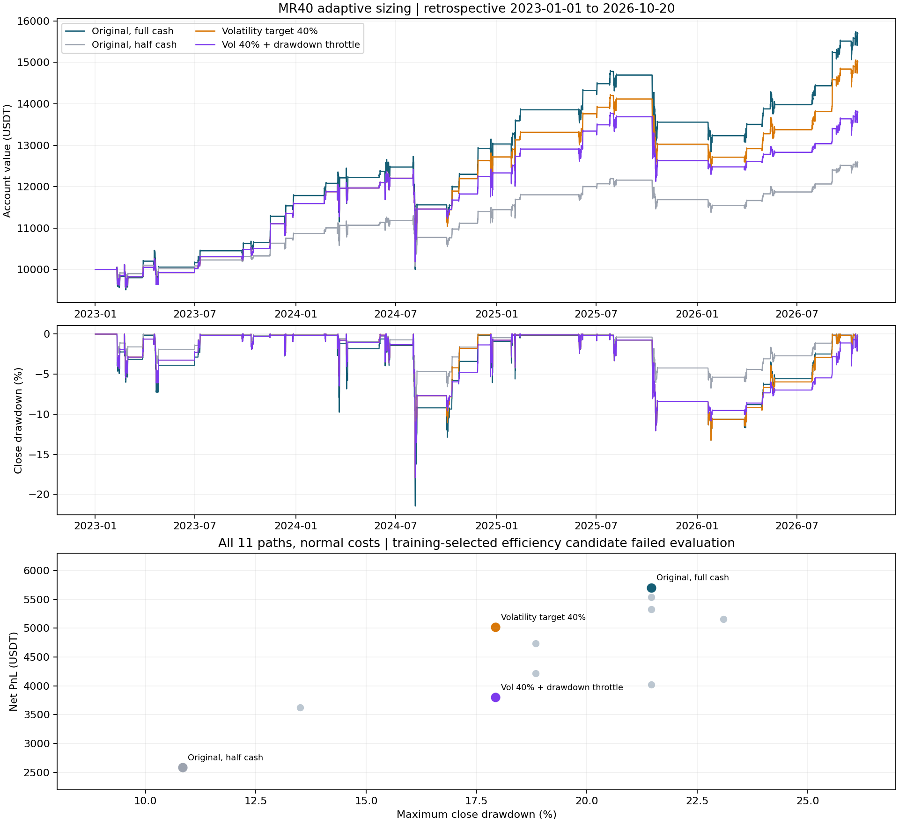

# ادامهٔ پژوهش MR40: حفظ خروج اصلی و حجم ورود متغیر

**نتیجه: حجم متناسب با نوسان، در کل سابقه مبادلهٔ متعادل‌تری میان سود و افت ایجاد کرد؛ اما بهبود در بخش ارزیابی تکرار نشد. نامزد انتخاب‌شدهٔ آموزشی برای جایگزینی دمو تأیید نشد.**

گزینهٔ انتخاب‌شده برای راندمان `b_vol40` است. در کل دوره، 88.02٪ سود پایه حفظ شد و افت نسبی 16.43٪ کمتر شد. انتخاب سود همچنان نسخهٔ اصلی باقی ماند. انتخاب راندمان در ارزیابی: `False`؛ بهبود سود جدید: `False`.

۱۱ مسیر پیش از اجرا ثبت شدند: هدف نوسان ۳۰/۴۰/۵۰٪، کاهش حجم هنگام افت ۵/۱۰٪ حساب، ترکیب این دو و تأیید برگشت. تمام مسیرها خروج اصلی MR40 را حفظ می‌کنند؛ هدف سود و حد ضرر تازه‌ای افزوده نشده است. حجم فقط هنگام ورود تعیین می‌شود و در پوزیشن باز تغییر نمی‌کند.

## مقایسهٔ کل سابقه

سرمایهٔ مستقل ۱۰٬۰۰۰ USDT؛ ۱ ژانویهٔ ۲۰۲۳ تا پیش از ۲۰ اکتبر ۲۰۲۶؛ دادهٔ Bybit با سناریوهای هزینه و محدودیت سفارش البانک. این بخش، تاریخچهٔ بلندمدت خود البانک نیست. افت‌ها از بسته‌شدن کندل چهارساعته محاسبه شده‌اند.

| حالت | سود خالص عادی | بیشترین افت | سود سختگیرانه | میانهٔ درصد نقد تخصیص‌یافته |
|---|---:|---:|---:|---:|
| نسخهٔ اصلی، ورود کامل | 5,699.89 | 21.45٪ | 2,411.93 | 100.00٪ |
| نسخهٔ اصلی، ورود نصف | 2,586.63 | 10.84٪ | 1,186.58 | 50.00٪ |
| تأیید برگشت، ورود کامل | 5,154.51 | 23.09٪ | 2,532.12 | 100.00٪ |
| هدف نوسان ۳۰٪ | 3,623.58 | 13.50٪ | 1,419.21 | 75.06٪ |
| هدف نوسان ۴۰٪ | 5,016.95 | 17.93٪ | 2,100.05 | 100.00٪ |
| هدف نوسان ۵۰٪ | 5,327.65 | 21.45٪ | 2,182.17 | 100.00٪ |
| تأیید برگشت + نوسان ۴۰٪ | 4,733.68 | 18.84٪ | 2,378.69 | 99.06٪ |
| نصف حجم پس از افت ۵٪ | 4,023.52 | 21.45٪ | 1,376.79 | 100.00٪ |
| نصف حجم پس از افت ۱۰٪ | 5,541.89 | 21.45٪ | 1,461.66 | 100.00٪ |
| نوسان ۴۰٪ + افت ۵٪ | 3,800.86 | 17.93٪ | 1,282.87 | 87.30٪ |
| تأیید + نوسان ۴۰٪ + افت ۵٪ | 4,217.24 | 18.84٪ | 1,689.52 | 97.80٪ |

گزینهٔ نوسان ۴۰٪ سود کل را از 5,699.89 به 5,016.95 و افت را از 21.45٪ به 17.93٪ رساند. این افزایش سود نیست؛ در این سابقه، کاهش حدود 16.43٪ افت در برابر کاهش حدود 11.98٪ سود بود.

## چرا در ارزیابی پذیرفته نشد؟

بخش ارزیابی: از ۱ ژانویهٔ ۲۰۲۵ تا پیش از ۲۰ اکتبر ۲۰۲۶. انتخاب فقط از آموزش ۲۰۲۳ و ۲۰۲۴ انجام شد و پس از ارزیابی عوض نشد.

| معیار | نسخهٔ اصلی | نامزد نوسان ۴۰٪ | شرط پذیرش |
|---|---:|---:|---:|
| سود عادی | 2,048.82 | 1,807.93 | حداقل 1,536.62 |
| افت عادی | 13.26٪ | 13.26٪ | حداکثر 10.61٪ |
| سود سختگیرانه | 793.82 | 630.38 | در نسبت راندمان استفاده می‌شود |
| نسبت راندمان | 0.2982 | 0.2376 | حداقل 0.3280 |

شرط حفظ سود پاس شد؛ اما افت در ارزیابی فقط 0.0046٪ به‌صورت نسبی کمتر شد، در برابر شرط ۲۰٪ کاهش. نسبت راندمان نیز به حد لازم نرسید. افتِ ظاهراً بهتر کل سابقه برای اعلام موفقیت کافی نبود.

## کاهش حجم پس از افت حساب

این قاعده پس از مشاهدهٔ افت، فقط ورود بعدی را کوچک می‌کند؛ افتِ پوزیشنی که از قبل باز شده را متوقف نمی‌کند. به همین دلیل، نصف‌کردن ورود پس از افت ۵٪، بیشترین افت کل را کم نکرد و بازیابی را کندتر کرد.

در حالت عادی، طولانی‌ترین مدت زیر قله برای پایه 403.83 روز و برای کاهش حجم پس از افت ۵٪ 445.83 روز شد. برای نامزد نوسان ۴۰٪ نیز 403.83 روز باقی ماند. بیشترین زمان نگهداری پایه و نامزد هر دو 228.00 ساعت بود؛ این تغییر ورود، خروج معامله را جلو نمی‌اندازد.

## ارزیابی مرحله‌ای و البانک

شش مرحلهٔ walk-forward، هر بار با آموزش بر گذشتهٔ همان مرحله، حساب مستقل و بستن انتهای مرحله؛ بازده‌ها هندسی ترکیب شده‌اند. این حساب مرحله‌ای با حساب پیوستهٔ کل دوره یکسان نیست.

| روش | سود مرکب با شروع ۱۰هزار، عادی | سختگیرانه |
|---|---:|---:|
| پایهٔ ثابت | 3,321.11 | 1,182.51 |
| انتخاب سود از گذشته | 2,681.93 | 699.29 |
| انتخاب راندمان از گذشته | 2,181.04 | 510.48 |

انتخاب راندمانِ متغیر نیز از پایهٔ ثابت ضعیف‌تر بود. انتخاب‌های شش مرحله در summary.json ثبت شده‌اند.

البانک: ۲۱ سپتامبر تا پیش از ۲۱ اکتبر ۲۰۲۶؛ فقط دو معامله. در این دو ورود، برآورد نوسان کمتر از سقف ۴۰٪ بود، بنابراین نامزد تمام نقد را تخصیص داد و دقیقاً با نسخهٔ اصلی برابر شد.

| سرمایه | سود پایه عادی | سود نامزد عادی | سود نامزد سختگیرانه |
|---|---:|---:|---:|
| 10,000 | 116.93 | 116.93 | 16.27 |
| 500 | 5.84 | 5.84 | 0.81 |

برابری این دو معامله، مزیت روی البانک یا کفایت نمونه برای تصمیم اجرایی را اثبات نمی‌کند.

## تعریف دقیق حجم و هزینه

حجم = کمینهٔ سقف نقد، هدف نوسان ÷ نوسان برآوردی، و سقف کاهش حجم در صورت فعال‌شدن شرط افت. هدف نوسان ۴۰٪ یعنی هدف سالانه‌شده در فرمول حجم؛ ورود ثابت ۴۰٪ سرمایه یا تضمین نوسان حساب ۴۰٪ نیست. نوسان از انحراف معیار جمعیتی آخرین ۱۸۰ بازده لگاریتمی بسته‌شده، ضرب در جذر ۲۱۹۱٫۵ به‌دست می‌آید.

افت مورد استفاده برای حجم از قلهٔ ارزش بسته‌شدهٔ همین حساب تا ارزش بسته‌شدهٔ آن در لحظهٔ تصمیم است. قله با خروج معامله بازنشانی نمی‌شود. در تأخیر دوکندلی نیز فقط مقدار قابل مشاهده در کندل تصمیم استفاده می‌شود، نه افت فعلی هنگام اجرا. پیش از آغاز هر حساب، افت صفر و قله برابر سرمایهٔ اولیه است. در مدت نگهداری بازتخصیص، اهرم، اضافه‌کردن خرید یا میانگین‌کم‌کردن وجود ندارد.

اجرای عادی و سختگیرانه در بازشدن کندل پس از تصمیم بسته‌شده است؛ تأخیر اضافه یک کندل دیگر صبر می‌کند. هزینهٔ هر سمت عادی: کارمزد ۰٫۱۰٪ و لغزش ۰٫۰۵٪؛ سختگیرانه: ۰٫۲۵٪ و ۰٫۱۵٪. این سناریوها جای نرخ حساب شخصی یا لغزش اندازه‌گیری‌شده را نمی‌گیرند. مقدار BTC به گام ۰٫۰۰۰۰۱ گرد می‌شود و حداقل ارزش سفارش ۱ USDT است. قواعد فعلی به تاریخ تعمیم داده شده‌اند؛ دفتر هزینه/صف واقعی بازار در دسترس نیست.

## ثبت و اعتبارسنجی

این ادامه پس از دیدن نتایج دو مطالعهٔ قبلی انتخاب شده و تمام تاریخ قبلاً دیده شده بود؛ پژوهش پارامتر گذشته‌نگر است، نه آزمون روی دادهٔ کاملاً دیده‌نشده. ۵۹۴ اجرای مدل و پنجره‌های هم‌پوشان، نمونه‌های مستقل بازار نیستند. از این مرحله به بعد پارامتری با مشاهدهٔ ارزیابی عوض نشد.

نامزد سود باید در آموزش سود عادی حداقل برابر پایه، سود سختگیرانه حداقل ۵٪ بیشتر و افت حداکثر ۱۰٪ بیشتر داشته باشد. نامزد راندمان باید حداقل ۷۵٪ رشد سالانهٔ عادی پایه را حفظ کند، افت بیشتر نداشته باشد و نسبت رشد سالانهٔ بدترِ دو سناریو به افت بدتر را حداقل ۱۰٪ بهبود دهد. کنترل ورود نصف در انتخاب شرکت ندارد. نوسان ۴۰٪ تنها نامزد واجد شرایط آموزشی بود؛ شرط ارزیابیِ افت و نسبت راندمان را پاس نکرد.

۵۹۴ بازسازی مستقل Decimal، ۶۶ برش زمانی و ۳۶ برابری منحنی کنترل با موتور قدیمی انجام شد؛ بیشترین خطای برابری کنترل صفر بود. ۱۲ تست جدید به‌علاوهٔ ۳۰ تست وابستگی قبلی در بسته قرار دارند. منبع، دو فریم ورودی دارای هش، تمام دفترها، منحنی‌ها، معیارها و verify_replay.py داخل ZIP هستند. بازپخش با Python 3.12+ و بدون شبکه یا کتابخانهٔ اضافی انجام می‌شود.

۸٬۵۱۴ کندل Bybit و ۶۷۲ کندل معتبر البانک شامل گرم‌کردن، از ورودی‌های ثابت قبلی استفاده شدند. سابقهٔ بلند البانک همچنان به‌دلیل ناسازگاری OHLC کنار گذاشته شده و اصلاح/پرکردن/حذف کندل انجام نشده است. تاریخ‌های پایان انحصاری و مبنای کندل UTC است. افت بسته‌شدن کندل می‌تواند افت واقعی داخل کندل را کمتر نشان دهد.

- پروتکل پیش از محاسبه: `a577a8a7b832bc96848d5cf72b9dce671609bbc1`
- موتور و تست‌ها پیش از محاسبه: `f42387ed7fc3b5318dd6e40b70d894f34b994c49`
- هش نتیجه: `eadbd63b9c70cff99e13de9bfae2c792108e5d1fb3fe825b23cac722bd90b519`
- هش فریم Bybit: `a458d9f83df633df8ee5cab5f2a19de41c4c79c61185b5abd258fdefa80d575a`
- هش فریم البانک: `7274373a6ff9e1a060da4c18dffe9da69436345657505cd52f768f11d04ab278`

نسخهٔ دمو تغییر نکرده و هیچ ارتقای خودکار، سفارش واقعی یا استفاده از API خصوصی انجام نشده است. هشت فایل اجرای Paper با هش قبلی برابر مانده‌اند. شش تست CI مرحلهٔ قبلی موفق بودند؛ وضعیت CI این شاخه در PR مستقل قابل مشاهده است.
