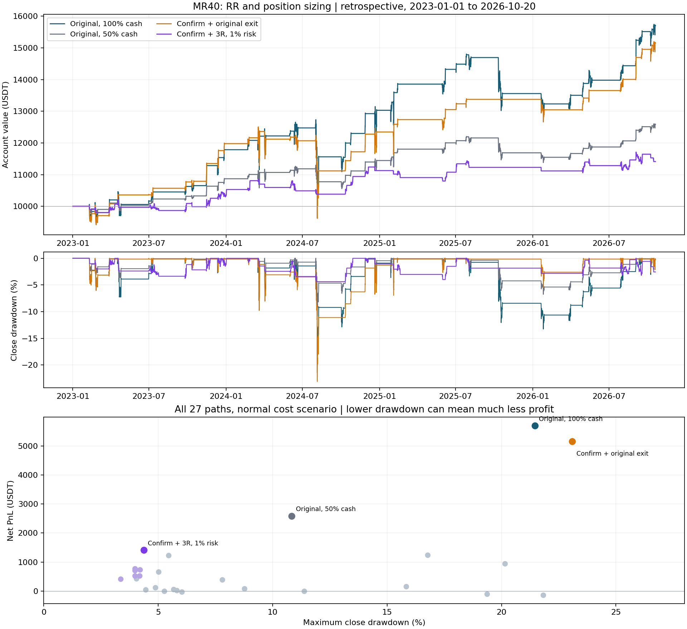

# آزمایش جداگانهٔ MR40: آر‌آر، حجم ورود و ترکیب سیستم‌ها

**نتیجه: در ۲۷ مسیر ازپیش‌ثبت‌شده، هیچ نامزد تازه‌ای معیار بهبود سود یا راندمان را در مرحلهٔ انتخاب پاس نکرد. هر دو انتخاب به نسخهٔ اصلی برگشتند.** کاهش حجم افت را کمتر کرد، اما سود هم کم شد. چند ترکیب کم‌افت‌تر بودند، ولی بخش عمدهٔ بازده یا دوام در سناریوی هزینهٔ بالاتر را از دست دادند.

این مطالعه دربارهٔ MR40 با ورود Z≤−2، خروج اصلی Z≥0 و فیلتر مومنتوم ۳۰روزه است؛ خرید نقدی BTC/USDT روی کندل چهارساعته، بدون اهرم. سودها خالص و به USDT هستند.

## مقایسهٔ کل دوره

از ۱ ژانویهٔ ۲۰۲۳ تا پیش از ۲۰ اکتبر ۲۰۲۶؛ سرمایهٔ مستقل ۱۰٬۰۰۰ تتر. دادهٔ اصلی Bybit با فرض‌های هزینه و محدودیت سفارش البانک؛ این بخش، سابقهٔ بلندمدت خود البانک نیست.

| سیستم | سود عادی | بیشترین افت بسته‌شدن کندل | سود با هزینهٔ سختگیرانه | رشد سالانهٔ مرکب عادی |
|---|---:|---:|---:|---:|
| نسخهٔ اصلی، ورود ۱۰۰٪ | 5,699.89 | 21.45٪ | 2,411.93 | 12.60٪ |
| نسخهٔ اصلی، ورود ۵۰٪ | 2,586.63 | 10.84٪ | 1,186.58 | 6.24٪ |
| نسخهٔ اصلی، ورود ۲۵٪ | 1,231.51 | 5.45٪ | 587.39 | 3.10٪ |
| تأیید برگشت، خروج اصلی | 5,154.51 | 23.09٪ | 2,532.12 | 11.56٪ |
| ورود اصلی، RR=2، ریسک ۱٪ | 85.45 | 8.77٪ | -690.96 | 0.22٪ |
| تأیید برگشت، RR=3، ریسک ۱٪ | 1,412.33 | 4.38٪ | 630.44 | 3.54٪ |
| تأیید برگشت، حد متحرک، ریسک ۱٪ | 770.88 | 3.98٪ | 75.90 | 1.97٪ |
| تأیید برگشت، خروج پله‌ای، ریسک ۱٪ | 711.57 | 3.98٪ | 209.22 | 1.83٪ |

ورود ۵۰٪، افت را از 21.45٪ به 10.84٪ رساند و سود را از 5,699.89 به 2,586.63 کاهش داد. مدت زیر قله ماندن در سناریوی عادی همچنان حدود 403.83 روز بود؛ حجم کمتر لزوماً زمان بازیابی را کوتاه نمی‌کند.

تأیید برگشت + RR=3 + ریسک ۱٪، در کل دوره 1,412.33 سود و 4.38٪ افت داشت، اما در انتخاب آموزشی به حداقل حفظ ۷۵٪ رشد سالانهٔ نسخهٔ اصلی نرسید. این ترکیب صرفاً یک نتیجهٔ اکتشافی است و به‌عنوان برنده انتخاب نشده است.

## بخش ارزیابی و البانک

ارزیابی: ۱ ژانویهٔ ۲۰۲۵ تا پیش از ۲۰ اکتبر ۲۰۲۶. البانک: ۲۱ سپتامبر تا پیش از ۲۱ اکتبر ۲۰۲۶، فقط دو معامله در نسخه‌های نشان‌داده‌شده. حساب هر پنجره از سرمایهٔ اولیهٔ خودش شروع می‌شود؛ سود پنجره‌ها قابل جمع ساده نیست.

| سیستم | ارزیابی عادی، ۱۰هزار | ارزیابی سختگیرانه، ۱۰هزار | البانک ۳۰روزه عادی، ۱۰هزار | البانک ۳۰روزه عادی، ۵۰۰ |
|---|---:|---:|---:|---:|
| نسخهٔ اصلی، ورود ۱۰۰٪ | 2,048.82 | 793.82 | 116.93 | 5.84 |
| نسخهٔ اصلی، ورود ۵۰٪ | 997.89 | 407.69 | 58.39 | 2.92 |
| نسخهٔ اصلی، ورود ۲۵٪ | 492.15 | 206.26 | 29.17 | 1.46 |
| تأیید برگشت، خروج اصلی | 2,275.75 | 1,331.95 | 131.70 | 6.58 |
| ورود اصلی، RR=2، ریسک ۱٪ | 490.67 | -98.39 | -198.98 | -9.94 |
| تأیید برگشت، RR=3، ریسک ۱٪ | 256.00 | -95.94 | -198.97 | -9.93 |
| تأیید برگشت، حد متحرک، ریسک ۱٪ | 200.85 | -85.95 | -198.97 | -9.93 |
| تأیید برگشت، خروج پله‌ای، ریسک ۱٪ | 442.23 | 185.07 | -198.97 | -9.93 |

روی البانک، حد ضرر ۲ATR در دو معامله فعال شد؛ بالاتر بردن هدف سود از ۱R به ۳R کمکی نکرد، چون معامله پیش از رسیدن به هدف متوقف شد. سود نسخهٔ اصلی با خروج میانگین، با سود فرضی معاملات دارای حد ضرر یکسان نیست.

تأیید برگشت با خروج اصلی در بخش ارزیابی بهتر بود، ولی در آموزش و افت کل سابقه برنده نبود. انتخاب آن پس از دیدن این بخش، یک انتخاب پس از مشاهدهٔ نتیجه خواهد بود.

## اندازهٔ ورود و آر‌آر

ورود ۲۵٪/۵۰٪/۱۰۰٪ یعنی کسری از نقد موجود. ریسک ۰٫۵٪/۱٪/۲٪ یعنی زیان اسمیِ برآوردشده تا حد ضرر اولیه، با هر دو کارمزد و لغزش، به‌عنوان کسری از حساب. حجم به نقد موجود محدود شده و اهرم ندارد. با تغییر سناریوی هزینه، حجم مدل ریسک ثابت هم دوباره محاسبه می‌شود؛ سناریوهای هزینه لزوماً تعداد BTC یکسانی نمی‌خرند.

| ورود اصلی، RR=2 | میانهٔ درصد سرمایهٔ درگیر | سود کل عادی | افت کل عادی | سود کل سختگیرانه |
|---|---:|---:|---:|---:|
| ریسک ۰٫۵٪ | 19.55٪ | 51.71 | 4.46٪ | -345.16 |
| ریسک ۱٪ | 39.09٪ | 85.45 | 8.77٪ | -690.96 |
| ریسک ۲٪ | 78.18٪ | 156.95 | 15.83٪ | -1,349.51 |

آر‌آر تنظیم‌شده فاصلهٔ قیمتِ هدف نسبت به فاصلهٔ حد ضرر است، نه نسبت سود و زیان خالص تحقق‌یافته. در RR=2 با ریسک ۱٪ و ورود اصلی، میانهٔ RR خالص برنامه‌ریزی‌شده در کل دوره حدود 1.71 بود. نصف خروج در ۱R و نصف در ۳R، پیش از هزینه‌ها تقریباً ۲R پاداش برنامه‌ریزی‌شده می‌دهد. نسبت متوسط برد به باخت تحقق‌یافته جداگانه در JSON ثبت شده است.

بیشترین زمان نگهداری نسخهٔ اصلی 228.00 ساعت، یعنی ۹ روز و ۱۲ ساعت بود. برای ورود اصلی با RR=2، این کران به 572.00 ساعت، یعنی ۲۳ روز و ۲۰ ساعت رسید. هدف ثابت می‌تواند سرمایه را مدت بیشتری درگیر کند. زمان خروج داخل کندل به‌صورت بازهٔ چهارساعته ثبت می‌شود؛ این اعداد کران بالای زمان هستند.

## حساسیت به اجرای سفارش

| سیستم | اجرای داخل کندل: سود / افت | یک کندل تأخیر اضافه: سود / افت | تأیید بسته‌شدن و اجرای بازشدن بعد: سود / افت |
|---|---:|---:|---:|
| ورود اصلی، RR=2، ریسک ۱٪ | 85.45 / 8.77٪ | 630.01 / 4.97٪ | 635.68 / 9.37٪ |
| تأیید برگشت، RR=3، ریسک ۱٪ | 1,412.33 / 4.38٪ | 1,411.27 / 4.60٪ | 1,549.19 / 6.16٪ |
| تأیید برگشت، حد متحرک، ریسک ۱٪ | 770.88 / 3.98٪ | 769.16 / 3.41٪ | 631.98 / 5.19٪ |
| تأیید برگشت، خروج پله‌ای، ریسک ۱٪ | 711.57 / 3.98٪ | 822.01 / 4.21٪ | 1,234.53 / 5.28٪ |

در حالت اصلی، حدها می‌توانند داخل کندل فعال شوند؛ گپ نامطلوب در قیمت بازشدن پر می‌شود، گپ مطلوب فقط قیمت هدف را می‌گیرد و اگر حد ضرر و سود در یک کندل لمس شوند، حد ضرر اول است. حد متحرک و سر‌به‌سر فقط از کندل بسته‌شدهٔ پس از ورود استفاده می‌کنند. دادهٔ تیک، عمق بازار، صف سفارش و پرشدن جزئی بازار مدل نشده‌اند؛ بازهٔ OHLC به‌تنهایی ترتیب واقعی قیمت‌ها را مشخص نمی‌کند.

در این داده‌ها هیچ کندل دوحدی ثبت نشد؛ آزمون حساسیت ترتیب فقط برای انتخاب‌های قفل‌شده و نسخهٔ اصلی انجام شد. این صفر بودن، نبود ابهام یا لغزش در بازار واقعی را اثبات نمی‌کند. با اجرای پس از بسته‌شدن، زیان بعضی معاملات با ریسک اسمی ۱٪ به بیش از ۲٪ حساب رسید. سر‌به‌سر و ریسک ثابت تضمین زیان صفر یا سقف زیان نیستند.

فرض هزینهٔ هر سمت: عادی کارمزد ۰٫۱۰٪ + لغزش ۰٫۰۵٪؛ سختگیرانه کارمزد ۰٫۲۵٪ + لغزش ۰٫۱۵٪. نرخ حساب شخصی و لغزش تاریخی واقعی در دسترس نیست؛ این‌ها سناریوهای مدل‌اند. حداقل سفارش ۱ USDT و گام ۰٫۰۰۰۰۱ BTC با قواعد فعلی به گذشته تعمیم داده شده‌اند.

## روش انتخاب و آزمون زمانی

آموزش: ۲۰۲۳ و ۲۰۲۴. انتخاب سود باید سود عادی حداقل برابر پایه، سود سختگیرانه حداقل ۵٪ بیشتر و افت حداکثر ۱۰٪ بیشتر از پایه داشته باشد. انتخاب راندمان، نسبت رشد سالانهٔ بدترِ دو سناریو به افت بدتر را بیشینه می‌کند؛ حداقل ۷۵٪ رشد سالانهٔ عادی پایه، افت حداکثر برابر پایه و بهبود حداقل ۱۰٪ این نسبت لازم است. کنترل‌های حجم ۲۵٪ و ۵۰٪ از رقابت انتخاب کنار گذاشته شده‌اند. هیچ مسیر جدیدی واجد شرایط نشد.

شش مرحلهٔ walk-forward با آموزش فقط بر گذشته و حساب مستقل در هر مرحله انجام شد. هزینهٔ بستن حساب هر مرحله محاسبه شده و بازده‌ها هندسی ترکیب شده‌اند؛ این مدل تحویل اجباری مرحله‌ای است، نه یک حساب پیوستهٔ بدون بستن.

| روش انتخاب | سود مرکب مراحل با شروع ۱۰هزار، عادی | سختگیرانه |
|---|---:|---:|
| پایهٔ ثابت | 3,321.11 | 1,182.51 |
| انتخاب سود از گذشته | 2,681.93 | 699.29 |
| انتخاب راندمان از گذشته | 2,681.93 | 699.29 |

انتخاب‌های دو روش در این شش مرحله یکسان شدند: نیمهٔ اول ۲۰۲۴، تأیید برگشت با خروج اصلی؛ پنج مرحلهٔ بعد، نسخهٔ اصلی. انتخاب متغیر از پایهٔ ثابت ضعیف‌تر شد.

تمام این سابقه در پژوهش‌های قبلی دیده شده بود. این یک جست‌وجوی پارامتر گذشته‌نگر با ۲۷ مسیر ازپیش‌ثبت‌شده است؛ تقسیم زمانی و walk-forward به‌معنای دادهٔ کاملاً دیده‌نشده نیستند. ۱٬۷۳۱ اجرای مدل نیز ۱٬۷۳۱ نمونهٔ مستقل بازار نیست.

## جدول کامل ۲۷ مسیر

b یعنی ورود اصلی؛ c یعنی تأیید برگشت حداکثر در سه تصمیم اول مجاز. rr هدف ثابت؛ hybrid زودتر از هدف یا خروج اصلی؛ be سر‌به‌سر پس از بسته‌شدن ۱R؛ trail حد متحرکِ بسته‌شدن−۲ATR؛ partial نصف در ۱R، بقیه در ۳R. a درصد نقد و r درصد ریسک اسمی را نشان می‌دهد. تمام مسیرهای حددار حد ضرر اولیهٔ ۲ATR20 دارند.

| شناسه | آموزش عادی | آموزش سختگیرانه | ارزیابی عادی | ارزیابی سختگیرانه | کل عادی | افت کل عادی | کل سختگیرانه |
|---|---:|---:|---:|---:|---:|---:|---:|
| baseline_a100 | 3,030.25 | 1,499.21 | 2,048.82 | 793.82 | 5,699.89 | 21.45٪ | 2,411.93 |
| baseline_a50 | 1,444.50 | 748.36 | 997.89 | 407.69 | 2,586.63 | 10.84٪ | 1,186.58 |
| baseline_a25 | 704.75 | 373.43 | 492.15 | 206.26 | 1,231.51 | 5.45٪ | 587.39 |
| confirm_natural_a100 | 2,345.08 | 1,059.12 | 2,275.75 | 1,331.95 | 5,154.51 | 23.09٪ | 2,532.12 |
| b_rr1_a100 | -226.29 | -2,049.39 | 125.87 | -727.87 | -103.25 | 19.36٪ | -2,628.07 |
| b_rr1_r1 | -41.49 | -632.89 | 107.90 | -230.98 | 65.91 | 5.68٪ | -849.15 |
| b_rr1p5_a100 | 4.15 | -1,345.42 | 1,236.91 | -465.30 | 1,241.52 | 16.77٪ | -1,748.02 |
| b_rr1p5_r1 | 86.80 | -404.17 | 572.20 | -117.50 | 664.02 | 5.01٪ | -516.89 |
| b_rr2_a100 | -999.23 | -1,789.94 | 957.37 | -379.34 | -137.53 | 21.82٪ | -2,101.48 |
| b_rr2_r1 | -386.28 | -598.55 | 490.67 | -98.39 | 85.45 | 8.77٪ | -690.96 |
| b_rr3_a100 | 284.44 | -544.79 | 643.81 | -201.18 | 946.60 | 20.15٪ | -735.05 |
| b_rr3_r1 | 72.61 | -177.62 | 312.97 | -86.05 | 387.91 | 7.79٪ | -262.08 |
| b_rr2_r05 | -190.47 | -300.23 | 246.86 | -46.30 | 51.71 | 4.46٪ | -345.16 |
| b_rr2_r2 | -669.28 | -1,151.28 | 885.52 | -224.09 | 156.95 | 15.83٪ | -1,349.51 |
| b_rr2_a25 | -226.86 | -448.05 | 251.23 | -77.47 | 18.65 | 5.81٪ | -522.10 |
| b_rr2_a50 | -470.11 | -897.08 | 495.07 | -166.79 | 1.68 | 11.38٪ | -1,048.95 |
| b_hybrid2_r1 | -180.48 | -647.41 | 156.63 | -236.58 | -26.67 | 6.03٪ | -868.66 |
| b_be2_r1 | -89.04 | -402.03 | 87.81 | -362.00 | -2.02 | 5.27٪ | -749.45 |
| b_trail2_r1 | 242.25 | -182.93 | -112.09 | -455.84 | 127.42 | 4.87٪ | -630.46 |
| b_partial3_r1 | 193.92 | -415.19 | 233.56 | -77.71 | 432.04 | 4.05٪ | -489.59 |
| c_hybrid2_r1 | 400.27 | 14.34 | 322.49 | -3.48 | 735.61 | 4.20٪ | 10.83 |
| c_be2_r1 | 289.05 | 43.42 | 120.59 | -265.57 | 413.11 | 3.35٪ | -223.35 |
| c_trail2_r1 | 558.85 | 163.29 | 200.85 | -85.95 | 770.88 | 3.98٪ | 75.90 |
| c_partial3_r1 | 257.92 | 23.59 | 442.23 | 185.07 | 711.57 | 3.98٪ | 209.22 |
| c_rr1p5_r1 | 490.26 | 163.82 | 40.52 | -282.41 | 532.71 | 4.18٪ | -123.20 |
| c_rr2_r1 | 439.95 | 125.56 | 89.00 | -232.92 | 532.85 | 3.99٪ | -110.32 |
| c_rr3_r1 | 1,127.48 | 733.40 | 256.00 | -95.94 | 1,412.33 | 4.38٪ | 630.44 |

## داده، بازتولید و محدودهٔ نتیجه

۸٬۵۱۴ کندل پیوستهٔ Bybit و ۶۷۲ کندل معتبر البانک شامل گرم‌کردن، با هش ثابت دوباره استفاده شدند. تاریخ پایان همهٔ پنجره‌ها انحصاری و مبنای داده UTC است. سابقهٔ بلند البانک به‌علت سه ناسازگاری OHLC رد شد و در این مطالعه وارد نشد؛ کندلی اصلاح، حذف یا پر نشده است. صحت یک فریم Bybit، برابری اجرای آن با بازار البانک را ثابت نمی‌کند.

افت گزارش‌شده بر اساس ارزش حساب در بسته‌شدن کندل چهارساعته است؛ می‌تواند افت واقعی داخل کندل را کمتر نشان دهد. سود کل با سود ماهانه یکسان نیست. معیار اصلی، سود بیشتر با ریسک قابل مقایسه بود و محقق نشد؛ کم‌کردن ریسک بدون حفظ بازده، به‌عنوان بهبود واجد شرایط اعلام نشده است.

کنترل‌ها: ۲۱ آزمون اجرای جدید + ۹ آزمون قبلی، ۱٬۷۲۸ بازسازی دفتر اصلی + ۳ تشخیصی، ۱۰۸ مقایسهٔ برش زمانی و ۱۲ برابری دقیق منحنی پایه با موتور قبلی؛ بیشترین خطای برابری پایه صفر بود. هشت فایل اجرای Paper با هش قبلی برابر ماندند. بازپخش کامل از ZIP استخراج‌شده با Python و بدون شبکه قابل اجراست.

قواعد پیش از اجرای اولیه در commit پروتکل ثبت شدند و موتور اولیه نیز پیش از محاسبه منتشر شد. پس از اجرای اولیه فقط شاخص پاداش برنامه‌ریزی‌شدهٔ خروج پله‌ای اصلاح شد تا دو خروج را با وزن واقعی جمع کند. این اصلاح هیچ سفارش، سود، افت یا انتخابی را تغییر نداد؛ تطابق دفترها و تمام معیارهای دیگر در بازاجرای نهایی کنترل شد.

- پروتکل: `cee93b288d59619571311e10d3b5f9a4ecf0206e`
- موتور اولیه: `a1b26dfb0d5f6330b4b8bd12336d8e9b6380a07a`
- موتور نهاییِ تصحیح شاخص: `aec22a7c00f1bbff9aa217daa751434adb4c8d4f`
- هش نتیجه: `d4bf7a4426d4b65399fa7f0a7470ce117b19fde92e9a16d6594360b2b17eebd0`
- هش ردیف‌های Bybit: `a458d9f83df633df8ee5cab5f2a19de41c4c79c61185b5abd258fdefa80d575a`
- هش ردیف‌های البانک: `7274373a6ff9e1a060da4c18dffe9da69436345657505cd52f768f11d04ab278`

فایل summary.json جدول‌های کلیدی را نگه می‌دارد؛ ZIP شامل منبع، ورودی‌های ثابت، تمام معیارها، دفترها، منحنی‌ها و verify_replay.py است. اجرای دمو و سفارش واقعی از این پژوهش تغییری نمی‌گیرد و هیچ نسخه‌ای خودکار ارتقا نمی‌یابد.

منابع توضیح مدل هزینه و محدودیت OHLC: [LBank](https://www.lbank.com/support/articles/42227167714585)، [مستندات API البانک](https://www.lbank.com/docs/)، [مدل اجرای کندل TradingView](https://www.tradingview.com/pine-script-docs/concepts/strategies/). نتایج عددی از اجرای کد و ورودی‌های بستهٔ پیوست‌اند.
